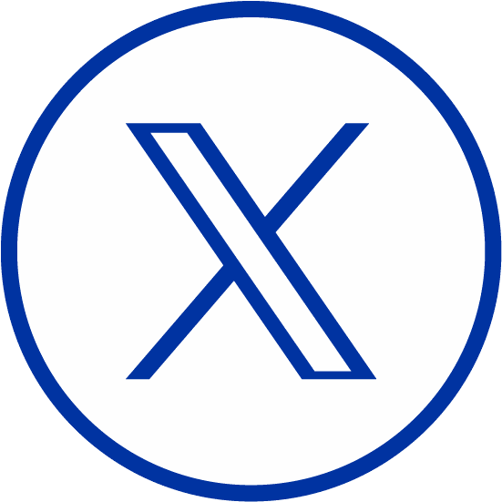

# Raccolta icone e header

Raccolta di icone PNG per social network, servizi, elementi generici e header destinati ai profili social.

## Standard grafici

### Icone social e generiche

- **Dimensione:** 551 × 551 px.
- **Formato:** PNG.
- **Colore del branding:** blu `#0033A1` (RGB 0, 51, 161).
- **Peso massimo:** 25 KB per file.
- **Sfondo:** area esterna trasparente; disco interno bianco; simbolo e contorno blu, secondo il disegno dell'icona.
- **Resa:** antialiasing e margini ottici uniformi. Non deformare né ridisegnare arbitrariamente i marchi dei servizi.

Le icone sono progettate per mantenere contrasto su sfondi bianchi, neri, grigi e colorati: la trasparenza riguarda l'esterno del disco, mentre le aree bianche interne previste dal disegno restano bianche.

### Avatar personali e loghi aziendali

I seguenti file sono esclusi dal refactoring e sono stati mantenuti invariati, senza ricampionamento, ritocco, ricompressione o modifica cromatica:

- `micheleicon.png` — 480 × 401 px
- `micheleicon1.png` — 480 × 401 px
- `micheleicon2.png` — 480 × 401 px
- `timicon.png` — 887 × 741 px
- `timicon_noovle.png` — 887 × 741 px

Non applicare a questi file lo standard cromatico `#0033A1`: i colori e l'aspetto originali devono essere preservati.

## Elenco delle icone

| File | Contenuto | Dimensioni | Peso massimo |
|---|---|---:|---:|
| `logobadge.png` | Distintivo / rosetta | 551 × 551 | 25 KB |
| `logocalendar.png` | Calendario | 551 × 551 | 25 KB |
| `logof.png` | Facebook | 551 × 551 | 25 KB |
| `logofediverse.png` | Simbolo Fediverso (@) | 551 × 551 | 25 KB |
| `logoin.png` | LinkedIn | 551 × 551 | 25 KB |
| `logoins.png` | Instagram | 551 × 551 | 25 KB |
| `logokey.png` | Chiave | 551 × 551 | 25 KB |
| `logomastodon.png` | Mastodon | 551 × 551 | 25 KB |
| `logosignal.png` | Signal | 551 × 551 | 25 KB |
| `logotelegram.png` | Telegram | 551 × 551 | 25 KB |
| `logowa.png` | WhatsApp | 551 × 551 | 25 KB |
| `logox.png` | X | 551 × 551 | 25 KB |
| `logoy.png` | YouTube | 551 × 551 | 25 KB |

## Header

Gli header sono conservati nella cartella `headers/`. Tutti sono in PNG. La conversione da JPG a PNG è lossless rispetto ai pixel decodificati dal JPEG; non è stato eseguito alcun ridimensionamento o intervento finalizzato a ridurre il peso dei file header.

| File | Piattaforma / progetto | Dimensioni |
|---|---|---:|
| `header-personal-linkedin-1584x396.png` | Personale / LinkedIn | 1584 × 396 |
| `header-personal-linkedin-1178x294.png` | Personale, 30 anni / LinkedIn | 1178 × 294 |
| `header-TIM-DC-linkedin-1584x396.png` | Aziendale TIM DC / LinkedIn | 1584 × 396 |
| `header-rock-facebook-1640x624.png` | Rock / Facebook | 1640 × 624 |
| `header-rock-x-1500x500.png` | Rock / X | 1500 × 500 |
| `header-rrmap-facebook-1640x624.png` | RRmap / Facebook | 1640 × 624 |
| `header-rrmap-linkedin-1584x396.png` | RRmap / LinkedIn | 1584 × 396 |
| `header-rrmap-x-1500x500.png` | RRmap / X | 1500 × 500 |
| `header-timenterprise-linkedin-780x140.png` | TIM Enterprise / LinkedIn | 780 × 140 |

### Naming convention

Usare nomi in minuscolo, separati da trattini, secondo lo schema:

`header-progetto-piattaforma-larghezza x altezza.png`

Esempio: `header-rock-facebook-1640x624.png`.

Le dimensioni nel nome descrivono i pixel effettivi del file. Mantenere il rapporto d'aspetto originale e verificare le specifiche aggiornate della piattaforma prima di pubblicare un header.

## Footer

Nell'archivio corrente non sono presenti immagini footer. Se ne verranno aggiunte in futuro, usare lo schema `footer-progetto-destinazione-larghezzaxaltezza.png`.

## Utilizzo

Markdown:

```markdown

```

HTML:

```html

```

Per mantenere la nitidezza, usare le icone alla dimensione nativa o ridurle; evitare ingrandimenti significativi. Non aggiungere sfondi opachi all'immagine se si desidera mantenere la trasparenza esterna.

## Struttura

```text
icons/
├── headers/
│   ├── header-personal-linkedin-1584x396.png
│   ├── header-personal-linkedin-1178x294.png
|   ├── header-TIM-DC-linkedin-1584x396.png
│   ├── header-rock-facebook-1640x624.png
│   ├── header-rock-x-1500x500.png
│   ├── header-rrmap-facebook-1640x624.png
│   ├── header-rrmap-linkedin-1584x396.png
│   ├── header-rrmap-x-1500x500.png
│   └── header-timenterprise-linkedin-780x140.png
├── logobadge.png
├── logocalendar.png
├── logof.png
├── logofediverse.png
├── logoin.png
├── logoins.png
├── logokey.png
├── logomastodon.png
├── logosignal.png
├── logotelegram.png
├── logowa.png
├── logox.png
├── logoy.png
├── micheleicon.png
├── micheleicon1.png
├── micheleicon2.png
├── timicon.png
├── timicon_noovle.png
├── LICENSE
└── README.md
```

## Licenza

La licenza del repository è descritta nel file `LICENSE`. I marchi dei servizi di terze parti restano di proprietà dei rispettivi titolari.
